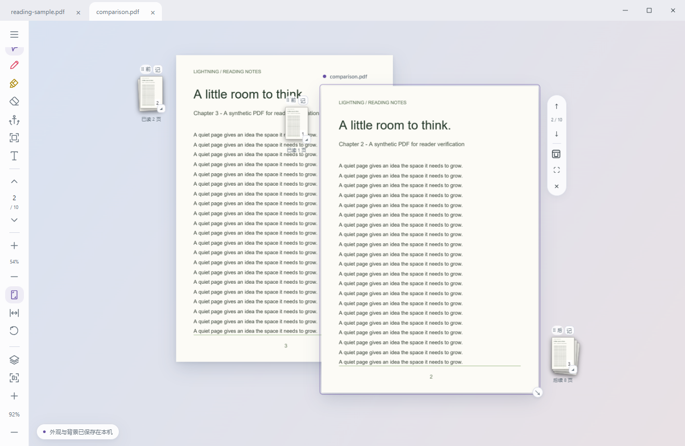

# 关于Lightning
Lightning是一款脱胎于本人AI4BOOK项目CRH的轻量级PDF阅读器，其包含了在CRH之中对于PDF阅读部分的全部特性，且轻量快速。
CRH源于对于多应用辗转阅读的困扰，而在构建一个比较好的PDF阅读器之后，本项目纯粹出于对于Adobe acrobat的恨意。

## 当前版本

Lightning 0.7.0 的源码支持 Windows / Ubuntu / Android，采用 Rust + Tauri 2 + PDFium，前端为 TypeScript + Vite，无前端框架。运行不依赖 CRH、Node、Python、账号或 AI 服务。本次新增 Ubuntu 修复包和 Android APK；已有 Windows 发布仍为 0.6.0。

- 单行文件标签与窗口三键，应用功能收进左侧折叠菜单，阅读工具默认展开为线条图标。
- 本地 PDF 文件选择、拖放、多标签、书签目录，阅读进度自动恢复。
- 每份文件左上角有自己的目录按钮，目录贴在该文件左侧并随其移动，切换文件时自动收起；桌面对象禁用浏览器文字 / 图片选区。
- 标签收纳：纸张与纸叠缩回对应标签，再次点击动画展开到原处；中途点击可反向播放，关闭仍用 ×。
- 每份文档独立选择摊开纸张或框内阅读；阅读框可拖动、调整宽高，翻页按框边缘对齐。
- 可选启动时重开上次文件组，恢复摆放、收纳状态、阅读框和阅读位置，或每次从第 1 页开始。
- 无界桌面：多份 PDF 直接铺成纸张，可拖动纸面自由摆放、重叠、置顶、等比例缩放；支持任意方向平移、视野缩放、查看全部与专注阅读。
- 桌面范围随展开的文件与纸叠延展，平移不会进入无限空白；拖文件到视野边缘会继续跟随并扩展。新文件始终出现在当前视野内。
- OCR、主题与启动恢复使用统一的圆角主题选项面板，支持键盘选择与选中标记。
- Material 风格的圆角界面，自定义主题色、浅色 / 深色 / 跟随系统、本地背景图片及其不透明度。
- Ctrl+滚轮只缩放鼠标下的 PDF，前后纸叠独立定尺寸；桌面上鼠标指向哪份文档就滚动哪份，大纸张先滚动后翻页；下一页对齐可视上缘，上一页对齐下缘。专注模式保留页内滚动、10%–800% 缩放和持续适配。
- 单按钮直接显示 / 隐藏纸叠，切换不改变正文位置和缩放；桌面纸叠可自由摆出纸张边界，随整份文件移动，正文滚动或缩放时留在桌上；双向翻页动画，分别记忆阅读篇幅，长按临时展开。
- 一次性阅读锚点，保存页码与双轴位置，成功返回后消费。
- 临时激光笔与激光荧光笔、画笔设置、可录入与保存的快捷键。
- 区域 PNG 截图与本地 OCR（Windows 系统引擎 / Ubuntu Tesseract），在独立本地面板查看、编辑文字、复制或保存截图。

[阅读框与标签收纳的实际界面](docs/images/workspace.png) · [启动与恢复设置](docs/images/workspace-settings.png)

[随文件移动的目录](docs/images/outline.png)

[自由摆放的纸叠](docs/images/paper-free-placement.png)

[统一选项面板](docs/images/themed-ocr-options.png) · [深色主题选项](docs/images/themed-dark-options.png)

## 开始使用

构建产物放在 `release/Lightning-0.6.0-windows-x64/`。双击其中的 `Lightning.exe`，保留旁边的 `pdfium.dll` 和许可证文件。也可以用随附合成文件 `reading-sample.pdf` 试读。

完整便携 ZIP 为 `release/Lightning-0.6.0-windows-x64.zip`；安装包为 `release/Lightning_0.6.0_x64-setup.exe`。安装包已生成，尚未进行干净系统的安装 / 卸载验收。

Ubuntu 安装包为 `release/Lightning_0.7.0_amd64.deb`。在该目录执行 `sudo apt install ./Lightning_0.7.0_amd64.deb`，然后从应用菜单启动。以 Ubuntu 22.04 为构建基线，已在 24.04 核对安装与运行；详见 [Ubuntu 安装说明](docs/ubuntu.md)。

Android 安装包为 `release/Lightning_0.7.0_android.apk`，适用于 Android 8.0 及以上的 ARM64 / x86_64。手机默认专注阅读，支持单指滚动与边缘翻页、双指缩放，以及外接键鼠；保留截图，不提供移动 OCR。详见 [Android 操作与构建](docs/android.md)。

[Ubuntu 实际阅读界面](docs/images/ubuntu.png) · [Ubuntu 主题设置](docs/images/ubuntu-theme.png)

从源码开发：安装 Node/pnpm、Rust/MSVC 与 Windows WebView2，然后执行 `pnpm install --frozen-lockfile`、`pnpm tauri dev`。产出独立程序执行 `pnpm release`。

## 项目文档

- [操作指南](docs/user-guide.md)
- [构建与分发](docs/build.md)
- [架构与状态设计](docs/architecture.md)
- [验证记录](docs/testing.md)
- [已知限制](docs/issues.md)
- [后续路线](docs/roadmap.md)
- [第三方来源](docs/third-party.md)
- [原始构建规格](Agent%20prompt.md)

原始任务文件保留不变。CRH 仅作为源码参考；不会改动原项目、个人 PDF、笔记或 `.crh` 文件。

## 许可证

Lightning 源码采用 [MIT 许可证](LICENSE)。随附的 PDFium 和第三方组件各自适用其原有许可证，见[第三方来源](docs/third-party.md)。
